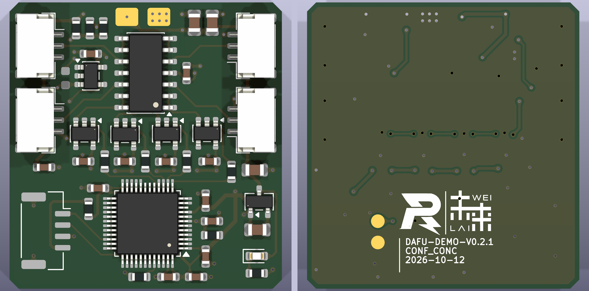

# DAFU

未来战队自研大符硬件方案，通过四通道半桥称重传感器采集正向毫秒级冲击波形，为环数检测提供信号。电路采用 **TLC2274A 缓冲、INA180A4 放大与 STM32F030 ADC 采集**，当前 PCB 版本为 **DAFU-DEMO-V0.2.1**。

## PCB 预览



## 主要参数

| 项目 | 详情 |
| :-- | --- |
| 输入通道 | 4 路三线半桥称重传感器 |
| 目标传感器 | 50 kg，1 mV/V，半桥总阻值 2 kΩ（1 kΩ / 1 kΩ） |
| 电源输入 / 传感器激励 | 5 V |
| 数字电源 | ME6206A33XG 输出 3.3 V |
| 模拟前端 | TLC2274AIDR 四路缓冲，INA180A4 差分增益 200 V/V |
| 基准缓冲 | UMW OPA333AIDBVR，5 V 供电 |
| 主控 | STM32F030C6Tx，LQFP-48 |
| 传感器接口 | J1–J4，JST GH 1.25 mm，3 Pin，卧贴 |
| 调试接口 | J5，Molex CLIK-Mate 1.25 mm，4 Pin，卧贴 |
| PCB 尺寸 | 30.0 × 31.6 mm，四角各 1 mm 倒角，面积 946.0 mm² |
| PCB 层数 / 厚度 | 双层 / 1.6 mm |
| 装配 | 42 个实际装配元件，均在正面；底面仅有复位测试焊盘 |

本仓库包含硬件工程和生产资料。冲击采样率、触发、波形存储和传输需要固件实现，当前资料未包含实测冲击响应、噪声或有效分辨率结论。

## 接口与测试点

接线请按焊盘编号核对，线束颜色和观察连接器的方向不能代替引脚定义。

| 接口 | 引脚 | 功能 / 网络 |
| --- | --- | --- |
| J1–J4：传感器接口 | 1 | +5V，传感器激励正极 |
| J1–J4：传感器接口 | 2 | IN1–IN4，对应通道的半桥中点信号 |
| J1–J4：传感器接口 | 3 | GND，传感器激励负极 |
| J1–J4 | MP | 连接器固定焊盘，接 GND |
| J5：SWD 调试接口 | 1 | SWDIO |
| J5：SWD 调试接口 | 2 | SWCLK |
| J5：SWD 调试接口 | 3 | GND |
| J5：SWD 调试接口 | 4 | +3.3V，经 R19 = 0 Ω 连接 |
| J5 | MP | 连接器固定焊盘，接 GND |
| TP1：正面电源焊盘 | 1 | +5V 输入 |
| TP2：正面电源焊盘 | 1 | GND |
| TP5：底面测试点 | 1 | NRST |
| TP6：底面测试点 | 1 | GND_RST，接 GND |

J5 使用 Molex CLIK-Mate 封装，与 J1–J4 的 GH 插座并非同一连接器系列。TP5 与 TP6 用于复位操作。

## 电路与采集

每路传感器中点信号先经 U6 电压跟随器缓冲，再由 INA180A4 相对公共基准放大。R9、R10 和 R12 将基准设置在 5 V 中点略下方，U9 对其缓冲，为正向信号保留输出余量。各路放大输出经 100 Ω 串联电阻送至 MCU 的 PA3、PA4、PA5、PA6。

按 5 V 激励、传感器灵敏度 1 mV/V 计算，50 kg 标称满量程对应约 5 mV 的输入变化，经过 200 倍放大后约为 1 V 的输出变化。理想无载基线约为 1.55 V，正向满量程约为 2.55 V；实际基线和量程仍需根据传感器零点、器件误差和装配结果校准。传感器接线方向应使目标冲击导致中点电压上升。

四路信号接入同一 MCU ADC，采样时序由固件配置。这些参数描述当前电路的标称关系，不代表已验证的动态测量性能。

## 主要器件

以下数量为单板用量。完整清单见 [生产 BOM](production/dafu/assembly/DAFU-BOM.csv)，采购时同时核对型号、封装和制造商。

| 位号 | 数量 | 型号 / 参数 | 封装 / 说明 |
| --- | --- | --- | --- |
| U1、U3、U4、U5 | 4 | INA180A4，增益 200 V/V | SOT-23-5 |
| U2 | 1 | STM32F030C6Tx | LQFP-48，当前 PCB 使用自定义焊盘版本 |
| U6 | 1 | Texas Instruments TLC2274AIDR | SOIC-14，四运放 |
| U7 | 1 | ME6206A33XG | SOT-23-3，3.3 V LDO |
| U9 | 1 | UMW OPA333AIDBVR | SOT-23-5，须匹配工程中的制造商和引脚定义 |
| J1–J4 | 4 | JST GH，1.25 mm，3 Pin，卧贴 | SM03B-GHS-TB 对应封装 |
| J5 | 1 | Molex CLIK-Mate，1.25 mm，4 Pin，卧贴 | 502386-0470 对应封装 |
| R5、R6 | 2 | 10 kΩ | 0603 |
| R9、R10、R11 | 3 | 5.1 kΩ | 0603 |
| R12 | 1 | 820 kΩ | 0603 |
| R13–R16 | 4 | 100 Ω | 0603，ADC 输入串联电阻 |
| R19 | 1 | 0 Ω | 0603 |
| C1–C9、C12、C13、C20、C21 | 13 | 100 nF | 0603 |
| C14、C15、C24、C25 | 4 | 10 µF | 0805 |
| D1 | 1 | LED | 0603 |
| C11 | 不装 | 100 nF | DNP，保留 PCB 焊盘与开窗 |

TP1、TP2、TP5、TP6 为裸 PCB 焊盘，不计入采购及贴装数量。

## 制造资料

```text
.
├── DAFU.kicad_pro                 KiCad 工程
├── DAFU.kicad_sch                 原理图
├── DAFU.kicad_pcb                 PCB
├── DAFU_Local.kicad_sym           项目本地符号库
├── DAFU_PCB.pretty/               项目本地封装库
├── docs/images/                   PCB 双面预览
└── production/                    制造资料
    ├── dafu.zip                   完整生产压缩包
    ├── dafu.zip.sha256            完整包 SHA-256
    ├── dafu-gerbers.zip           单独打板包
    ├── dafu-gerbers.zip.sha256     打板包 SHA-256
    └── dafu/
        ├── gerbers/               Gerber、钻孔与钻孔报告
        ├── assembly/              BOM、贴装坐标与装配图
        ├── previews/              铜层、丝印及 3D 预览
        ├── documentation/         DRC、ERC、板数据及导出说明
        └── manifest.json          源文件和输出文件校验值
```

工程使用 KiCad 10.0.5。项目符号库与封装库通过 `${KIPRJMOD}` 引用，3D 模型使用 KiCad 标准模型目录。制造文件根据 2026-10-12 保存的工程导出，底层 GND 为实心直连铺铜，保留 279 个原生泪滴。Gerber 无需镜像。

本版检查结果为 ERC 0 项、活动 PCB DRC 违规 0 项、未连接 0 项。保留的原理图一致性警告包括 C11 的 DNP 属性不同步，以及 U2 缺少 10、17、18、19 号焊盘；这四脚在原理图中均标注 No Connect，在当前 PCB 中没有铜焊盘、阻焊或锡膏开窗。另有一项既有的 U2 封装库不匹配排除项。详细记录见 [生产说明](production/dafu/README.md) 和 [检查资料](production/dafu/documentation/)。

C11 按原理图不装，贴装文件包含 42 个正面元件，底面无贴装元件。原始 PCB 上 C11 的焊盘、阻焊和锡膏开窗予以保留；贴装时应以 BOM 的 DNP 标记和装配图为准。
